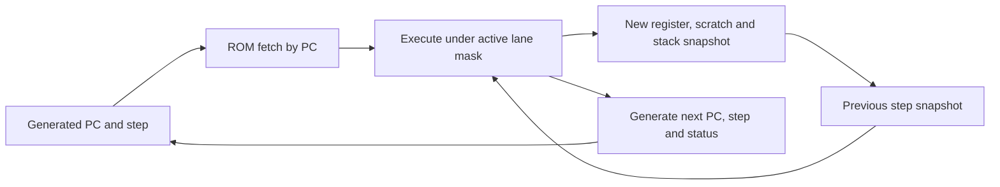

# Bounded loops and divergent control

`qwengpu/compiled_control.py` combines ROM fetch, internal writeback,
two-level IF/ELSE/ENDIF divergence, and two-level data-dependent WHILE loops
in stock Qwen3.5 layers. It retains eight byte lanes and four scratch bytes
per lane. Programs contain at most 16 instructions and run for at most 16
executed instructions, including control operations and HALT.

## Program address and execution step

The model-generated control token holds a four-bit PC, a four-bit execution
step, and separate HALT and exhausted bits. The caller feeds this token back
unchanged. A backward PC jump selects an earlier ROM instruction, while the
execution step advances to a fresh pipeline snapshot. The new step therefore
reads the previous iteration's updated state instead of an old PC-indexed
snapshot. Each instruction still uses only TICK and generated-state feedback.
The host does not dispatch instructions, choose branch decisions, or feed back
lane values.

The diagram's state edge moves forward in model depth. There are 16 allocated
execution stages; it does not imply unlimited cyclic state reuse. The circuit
has 69 layers, 75 heads, 19,264 logical dimensions, and 26,115 FFN units.
Shared residual slots keep the physical model width smaller than the logical
dimension count. The pretrained merge adds an exit marker layer.

## Instructions and masks

The ISA is ADDI, XORI, STORE, LOAD, HALT, IF_LT, ELSE, ENDIF, WHILE_LT,
and ENDWHILE. ADD/XOR/STORE/LOAD modify active lanes only. Scratch addresses
remain 0, 8, 16, and 24, with the lane index selecting its byte within a bank.

IF_LT saves the parent mask and the subset whose current byte is below its
unsigned byte argument. ELSE selects the saved parent minus that saved then
subset; it does not recompute the comparison after then-path arithmetic.
ENDIF restores the saved parent. Both paths execute under disjoint masks.
The branch stack holds two frames. The loader enforces one ELSE at most and
proper nesting, so hardware frames need only parent and then masks.

WHILE_LT computes the subset of currently active lanes below its argument.
If that subset is empty, the model jumps past the matching ENDWHILE. Otherwise
it saves the parent mask on a separate loop stack and runs the body under the
subset. ENDWHILE restores that parent, pops the loop frame, and jumps back to
WHILE_LT for another comparison. Lanes that finish early retain their values
while other lanes continue. All participating lanes reconverge when the loop
exits. The loop stack also holds two frames. Branches can contain loops and
loops can contain branches, with properly nested blocks. Both stacks can
reach depth two simultaneously.

## Upload and state inspection

ROM payloads pack a four-bit opcode and byte argument. Upload tokens use a
compact stride of ten opcodes per address, keeping the full vocabulary at
65,536 IDs. A second 16-row link table holds the resolved target of each
WHILE_LT and ENDWHILE. The loader resolves these static links; it does not
choose runtime jumps. The independent interpreter finds matching loop ends
from program structure, without consuming uploaded link tokens.

A launch uploads eight initial lane bytes, all 16 ROM rows, all 16 link rows,
and the initial control token: 41 tokens total. Every launch uses a fresh
cache. Each execution stage writes a 380-bit snapshot across four DeltaNet
heads: registers, scratch, active mask, both stack depths, both branch frames,
and both loop-parent masks. Popped frames are cleared. The evaluator checks
every snapshot and retained control state, plus final ROM and link rows.

## Limits and acceptance

The 16th instruction emits exhausted if it does not HALT; a HALT at that
boundary takes precedence. Exhaustion is a distinct outcome, not successful
completion. The nonterminating fixture must return exhausted exactly at the
budget. Increasing the budget requires more depth and a wider step encoding.
There are no unrestricted jumps, arbitrary-length loops, reductions, larger
scratch spaces, or multiple warps in this variant.

Fourteen frozen programs cover nested divergence, empty/full masks, branches
inside loops, loops inside branches, differing lane trip counts, zero
iterations, masked scratch writes, wraparound, simultaneous maximum stack
depths, and exhaustion. The first 13 and the supplemental combined-depth case
passed on MPS in separate runs. Together they contain 130 executed
instructions. The unsigned byte comparison and byte adder each passed all
65,536 input pairs in the compiler evaluator. All 21 local tests pass.
CUDA and 9B evidence is recorded in VALIDATION.md. These bounded checks do not
establish correctness for every valid program or an acceleration result.
