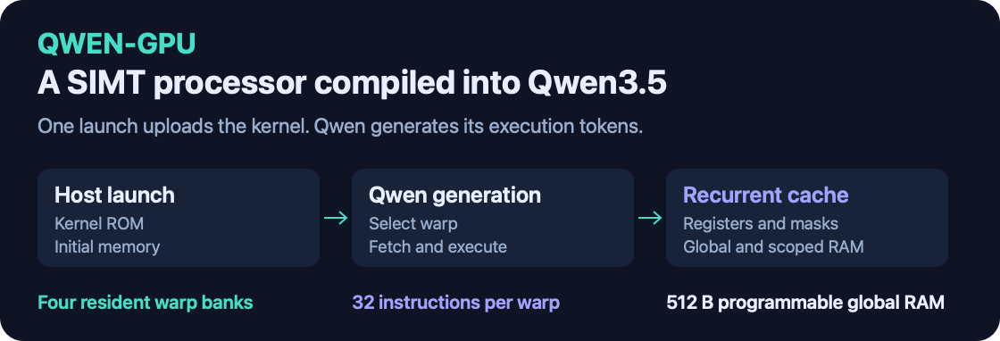
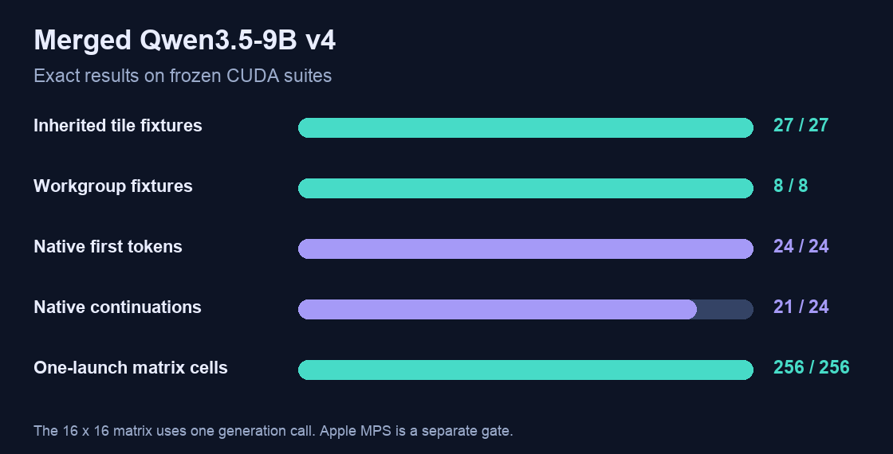

# Qwen-GPU

A bounded, programmable SIMT processor compiled into Qwen3.5. The host
uploads a kernel and its inputs. Qwen selects warps, fetches instructions,
and updates registers and memory through its generated tokens.



## What runs today

| Capability | Resident generation v4 |
| --- | --- |
| Execution | Two eight-lane warps per workgroup; four sequential or two interleaved workgroups |
| Programs | 32 instructions per warp, loops, divergent branches, barriers, and deadlock detection |
| Memory | 512 bytes of programmable global RAM, plus scoped shared and private memory |
| Arithmetic | 32-bit integer and address operations, indexed loads and stores, and tiled multiply |
| Matrix | Full 16×16 multiply across eight model-scheduled panels in one generation call |
| Text | The same merged 9B weights produce ordinary text and preserve audited GPU state across text handoffs |

## Validation



The fixed v4 merge passed the complete CUDA qualification: all 27 inherited
tile fixtures, eight workgroup fixtures, 31 common compute requests, seven
raw memory cases, full-width integer programs, and the native-text gate.
The 16×16 matrix emitted 20,167 exact tokens over 928 instructions and
produced all 256 correct cells in one launch. Native text matched 24 of
24 first tokens and 21 of 24 short greedy continuations, with no GPU
token IDs. [Reports and reproduction commands](VALIDATION.md)

Each generated token requires a model forward pass, so the current
machine is slow. Apple MPS qualification of v4 remains pending. The
private v4 checkpoint package passed its 48-file checksum pass, but its
upload and clean restore are pending private storage capacity. The
[release receipt](RELEASE.md) tracks that gate. The previously verified
v3 checkpoint remains available at its pinned revision.

## Run the verified v3 checkpoint

The merged weights occupy about 86 GB. The verified v3 release was
restored on a 96 GB CUDA GPU. From a QwenGPU checkout, download its
immutable revision. Sign in with `hf auth login` if the private model
repository requires access.

```bash
checkpoint=./Qwen-GPU-v3
hf download arpjw/Qwen-GPU \
  --revision fe671778a2409a218dde757871f33f5ca46d9219 \
  --exclude .gitattributes --local-dir "$checkpoint"

python -m qwengpu.run_resident eval/frozen/tile8_gate_v1/dense_seeded.json \
  --model "$checkpoint" --device cuda --check-reference --out tile.json

python -m qwengpu.run_compute examples/memory512_reduce_128.json \
  --model "$checkpoint" --device cuda --out reduction.json
```

The [reproduction guide](REPRODUCE.md#run-the-stock-generation-checkpoint)
includes the pinned environment, build path, and v4 qualification command.

## Project details

- [Scope and remaining gates](SCOPE.md)
- [Checkpoint release and restore](RELEASE.md)
- [Stock-generation protocol](MODEL_WRITEBACK_DESIGN.md)
- [Development history and earlier launchers](docs/DEVELOPMENT_HISTORY.md)

Qwen-GPU builds on [QwenCPU](https://github.com/arpjw/qwencpu) and uses
[Qwenputer](https://github.com/divagr18/qwenputer) to compile the circuit.
The source is MIT-licensed. The derived checkpoint carries the
Qwen3.5-9B Apache 2.0 license. [License and attribution](RELEASE.md#license-and-attribution)
