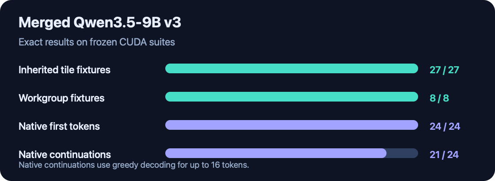

# Qwen-GPU

A bounded, programmable SIMT processor compiled into Qwen3.5. The host
uploads a kernel and its inputs. Qwen selects warps, fetches instructions,
and updates registers and memory through its generated tokens.


## What runs today

| Capability | Resident generation v3 |
| --- | --- |
| Execution | Two eight-lane warps per workgroup. Up to four sequential workgroups or two interleaved workgroups |
| Programs | 32 instructions per warp, with loops, divergent branches, barriers, and deadlock detection |
| Memory | 512 bytes of programmable global RAM, plus scoped shared and private memory |
| Arithmetic | 32-bit integer and address arithmetic, indexed loads and stores, and tiled multiply |
| Verified CUDA workloads | 64-element vector add, 128-element two-pass reduction, 8×4 by 4×4 matrix multiply, and the inherited tile suite |
| Native text | The same weights produce ordinary text. Four GPU-to-text handoff tests preserved the audited GPU state |

## Validation



The 27 tile fixtures matched **26,225 generated tokens over 1,972
instructions**, with exact final memory and zero host-supplied execution
tokens. Native text matched all 24 first tokens and 21 of 24 full
continuations. The second launch of the 128-element reduction reused global
memory with zero re-upload. Each generated token requires a model forward
pass. The full v3 Apple MPS replay is pending.

A clean download passed all 49 package checksums and reproduced the seeded
tile and native-text results. [Restore receipt and verifier output](RELEASE.md#restore-receipt)

## Run a kernel

The merged weights occupy about 86 GB. Qualification used a 96 GB NVIDIA
RTX PRO 6000 Blackwell Server Edition GPU. From the QwenGPU checkout,
download the verified revision. If the model repository requires access,
sign in with `hf auth login` first.

```bash
checkpoint=./Qwen-GPU-v3
hf download arpjw/Qwen-GPU \
  --revision fe671778a2409a218dde757871f33f5ca46d9219 \
  --exclude .gitattributes --local-dir "$checkpoint"
```

Set up the pinned environment and run a kernel.
The same guide includes the build-from-source path. [Reproduction guide](REPRODUCE.md#run-the-stock-generation-checkpoint)

```bash
python -m qwengpu.run_resident eval/frozen/tile8_gate_v1/dense_seeded.json \
  --model "$checkpoint" --device cuda --check-reference --out tile.json

python -m qwengpu.run_compute examples/memory512_reduce_128.json \
  --model "$checkpoint" --device cuda --out reduction.json
```

## Project details

- [Validation and saved reports](VALIDATION.md)
- [Stock-generation protocol](MODEL_WRITEBACK_DESIGN.md)
- [Scope and remaining gates](SCOPE.md)
- [Checkpoint release and restore](RELEASE.md)
- [Development history and earlier launchers](docs/DEVELOPMENT_HISTORY.md)

Qwen-GPU builds on [QwenCPU](https://github.com/arpjw/qwencpu) and uses
[Qwenputer](https://github.com/divagr18/qwenputer) to compile the circuit.
The source is MIT-licensed. The Hugging Face checkpoint derives from
Qwen3.5-9B under Apache 2.0. [License and attribution](RELEASE.md#license-and-attribution)
